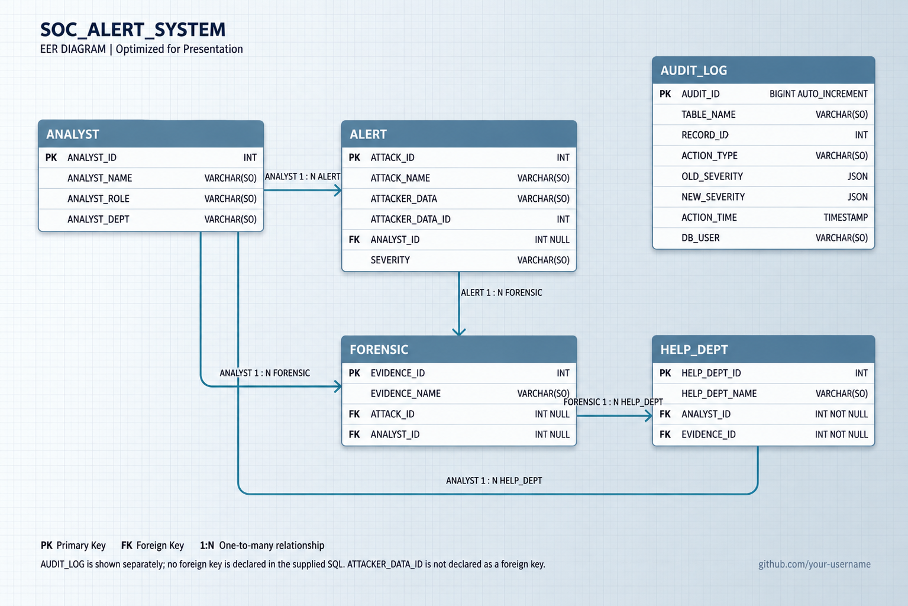

# -SOC-ALERT-MANAGEMENT-SYSTEM
A MySQL-based Security Operations Center (SOC) Alert Management System for organizing security alerts, analyst records, forensic data, and help department activities. Features relational database design, Role-Based Access Control (RBAC), user privileges, and audit triggers for controlled access and activity tracking.

## Entity Relationship Diagram

The following diagram illustrates the database structure and relationships between the entities.

